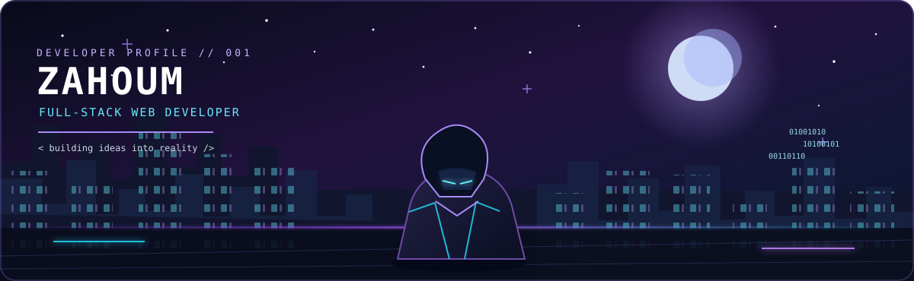

<div align="center">
  

  <br />

  <a href="https://github.com/zahoum">
    
  </a>

  <p>
    
    <a href="https://github.com/zahoum?tab=followers"></a>
    <a href="https://github.com/zahoum?tab=repositories"></a>
  </p>
</div>

---

## 🌌 `who am i` — A little about me

```yaml
name: Zahoum
role: Full-Stack Web Developer
interests:
  - Building responsive web experiences
  - Frontend interfaces and user experience
  - Backend logic and database design
  - Learning new tools by building real projects
mindset: "Stay curious. Write clean code. Keep improving."
```

I enjoy bringing ideas to life through code — from a thoughtful user interface to the logic and data behind it. I care about building websites that are **useful, responsive, maintainable, and enjoyable to use**.

- 🔭 **I like building:** full-stack web apps and interactive interfaces.
- 🧠 **My approach:** understand the problem, keep the solution clear, then improve it step by step.
- ⚡ **Developer rule:** ship something useful, learn from it, and make the next version better.

---

## 🧰 Tech stack & tools

<div align="center">
  
</div>

<div align="center">
  
  
  
  
</div>

---

## 📊 GitHub command center

<div align="center">
  <a href="https://github.com/zahoum">
    
  </a>
  <a href="https://github.com/zahoum?tab=repositories">
    
  </a>
</div>
<p align="center">
  
</p>

<div align="center">
  
</div>

---

## 🐍 The contribution trail

<div align="center">
  <picture>
    <source
      media="(prefers-color-scheme: dark)"
      srcset="https://raw.githubusercontent.com/zahoum/zahoum/output/github-contribution-grid-snake-dark.svg"
    />
    <source
      media="(prefers-color-scheme: light)"
      srcset="https://raw.githubusercontent.com/zahoum/zahoum/output/github-contribution-grid-snake.svg"
    />
    
  </picture>
</div>

## 🎯 What I value when building

<table>
  <tr>
    <td width="33%" align="center">
      <h3>✨ Thoughtful UI</h3>
      Clear layouts, responsive pages, and interactions that feel natural.
    </td>
    <td width="33%" align="center">
      <h3>⚙️ Solid logic</h3>
      Readable code, predictable behavior, and practical backend solutions.
    </td>
    <td width="33%" align="center">
      <h3>🚀 Continuous growth</h3>
      Experiment, accept feedback, and improve one feature at a time.
    </td>
  </tr>
</table>

---

## 🤝 Connect

<div align="center">
  <a href="https://github.com/zahoum">
    
  </a>
</div>

<div align="center">
  <h3>Thanks for stopping by ✨</h3>
  <i>Every great project starts with curiosity — see you in the next commit.</i>
  <br /><br />
  
</div>
